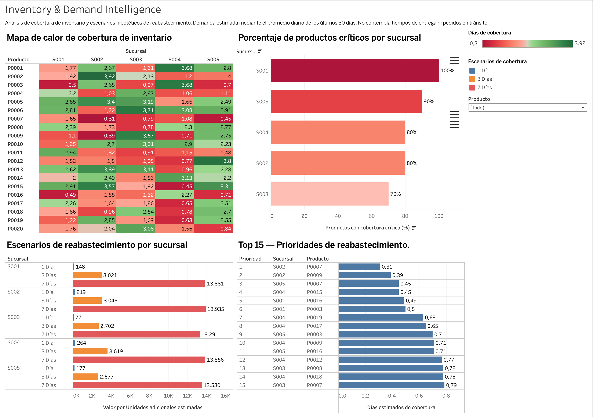

# Inventory & Demand Intelligence
### Análisis de demanda, cobertura de inventario y escenarios de reabastecimiento

**Herramientas:** Python · Pandas · SQL (DuckDB) · Tableau Public

[**Explorar dashboard interactivo en Tableau Public**](https://public.tableau.com/app/profile/josue.mayoral.torres/viz/InventoryDemandIntelligence/InventoryDemandIntelligence)



---

## 1. Descripción del proyecto

Este proyecto analiza la demanda y la cobertura de inventario de una cadena minorista simulada, utilizando información histórica de ventas, inventarios y pronósticos de demanda.

El propósito es transformar registros operativos en indicadores que permitan comparar sucursales, identificar combinaciones de productos con menor cobertura y evaluar escenarios hipotéticos de reabastecimiento.

El procesamiento y análisis se realizaron mediante Python y SQL, mientras que los resultados se presentan en un dashboard interactivo desarrollado en Tableau Public.

## 2. Objetivos de negocio

El análisis busca responder tres preguntas:

1. ¿Qué productos presentan mayor demanda y cómo varía entre sucursales?
2. ¿Qué combinaciones de producto y sucursal tienen menor cobertura de inventario?
3. ¿Qué combinaciones deberían revisarse primero y cómo cambian las necesidades estimadas bajo diferentes objetivos de cobertura?

## 3. Datos utilizados

Se utilizó un dataset sintético de operaciones minoristas.

| Característica | Descripción |
|---|---|
| Registros originales | 73,100 |
| Sucursales | 5 |
| Productos | 20 |
| Periodo | 2022 a enero de 2024 |
| Granularidad original | Producto × Sucursal × Día |
| Granularidad analítica final | 100 combinaciones producto-sucursal |

Las principales variables utilizadas incluyen ventas diarias, inventario disponible, unidades ordenadas y pronósticos de demanda.

### Fuente de datos y licencia

Dataset: [Retail Store Inventory Forecasting Dataset](https://www.kaggle.com/datasets/anirudhchauhan/retail-store-inventory-forecasting-dataset), publicado por Anirudh Singh Chauhan en Kaggle.

El dataset se identifica como sintético y se reporta bajo licencia CC0 (dominio público), que permite su modificación y redistribución. Se recomienda consultar la ficha original para verificar los términos vigentes.

## 4. Metodología

### Etapa 1. Exploración y evaluación de calidad de datos (EDA)

Se revisaron la estructura del dataset, los tipos de datos, registros duplicados, valores faltantes y distribuciones de las principales variables.

Durante el análisis se identificaron **673 registros con pronósticos de demanda negativos**. Se evaluó su comportamiento y se conservaron los valores originales para mantener la trazabilidad.

También se creó una variable de pronóstico ajustado, limitando los valores negativos a cero para los análisis que requirieran valores no negativos.

### Etapa 2. Limpieza y transformación de datos (ETL)

Se estandarizaron los nombres de las columnas, se validaron los tipos de datos y se preparó una tabla diaria para el análisis.

El conjunto procesado se exportó como `inventory_daily.csv` y se utilizó como fuente para las consultas SQL ejecutadas con DuckDB.

### Etapa 3. Análisis de demanda e inventarios con SQL

Se analizaron las ventas por producto y sucursal, y se construyeron indicadores de demanda y cobertura.

**Indicadores principales:**

- **Demanda diaria promedio:** promedio de unidades vendidas durante los últimos 30 días disponibles.
- **Inventario actual:** último nivel de inventario registrado para cada combinación producto-sucursal.
- **Días de cobertura:** inventario actual dividido entre demanda diaria promedio.
- **Prioridad de revisión:** ordenamiento ascendente por días de cobertura, utilizando las unidades adicionales para tres días como criterio secundario.

Se evaluaron escenarios hipotéticos de cobertura objetivo de 1, 3 y 7 días.

### Etapa 4. Visualización en Tableau Public

Se desarrolló un dashboard interactivo compuesto por cuatro visualizaciones:

1. Mapa de calor de cobertura por producto y sucursal.
2. Porcentaje de productos críticos por sucursal.
3. Escenarios de reabastecimiento para 1, 3 y 7 días.
4. Ranking de las 15 combinaciones con menor cobertura.

El dashboard permite explorar los resultados mediante filtros por sucursal y producto.

## 5. Resultados principales

### 5.1. Cobertura y riesgo por sucursal

De las 100 combinaciones analizadas, **84 presentan una cobertura estimada de 3 días o menos**, utilizando el umbral hipotético establecido.

| Sucursal | Productos críticos | Porcentaje crítico | Cobertura promedio |
|---|---:|---:|---:|
| S001 | 20/20 | 100% | 1.90 días |
| S005 | 18/20 | 90% | 2.10 días |
| S002 | 16/20 | 80% | 2.07 días |
| S004 | 16/20 | 80% | 1.69 días |
| S003 | 14/20 | 70% | 2.07 días |

S001 presenta la mayor proporción de productos críticos, mientras que S004 registra la menor cobertura promedio.

Ambos indicadores aportan perspectivas complementarias: una mayor proporción de productos críticos no implica necesariamente tener las combinaciones individuales con menor cobertura.

### 5.2. Ranking de prioridades de reabastecimiento

| Prioridad | Sucursal | Producto | Cobertura | Unidades adicionales para 3 días |
|---|---|---|---:|---:|
| 1 | S002 | P0007 | 0.31 días | 453 |
| 2 | S002 | P0009 | 0.39 días | 413 |
| 3 | S005 | P0007 | 0.45 días | 331 |
| 4 | S004 | P0015 | 0.45 días | 315 |
| 5 | S001 | P0016 | 0.49 días | 379 |

La combinación **S002–P0007** presenta la menor cobertura estimada, con 0.31 días.

El ranking prioriza principalmente las combinaciones con menor cobertura, no necesariamente aquellas que requieren más unidades adicionales.

### 5.3. Escenarios de reabastecimiento

Se calcularon las unidades adicionales estimadas para alcanzar tres objetivos de cobertura:

| Sucursal | 1 día | 3 días | 7 días |
|---|---:|---:|---:|
| S001 | 148 | 3,021 | 13,881 |
| S002 | 219 | 3,045 | 13,935 |
| S003 | 77 | 2,702 | 13,291 |
| S004 | 264 | 3,619 | 13,856 |
| S005 | 177 | 2,677 | 13,530 |
| **Total** | **885** | **15,064** | **68,493** |

S004 presenta el mayor requerimiento estimado en los escenarios de 1 y 3 días, mientras que S002 registra el mayor requerimiento en el escenario de 7 días.

Los escenarios permiten comparar objetivos de cobertura, pero no representan pedidos de compra reales.

## 6. Interpretación y recomendaciones

Los indicadores muestran tres perspectivas distintas:

- **S001:** mayor proporción de productos clasificados como críticos.
- **S004:** menor cobertura promedio por producto.
- **S002–P0007:** combinación individual con menor cobertura estimada.

A partir de los resultados se propone:

- Revisar inicialmente las combinaciones con menor cobertura estimada.
- Complementar el porcentaje de productos críticos con indicadores de cobertura promedio y demanda.
- Comparar distintos objetivos de cobertura antes de establecer cantidades de reposición.
- Incorporar información sobre tiempos de entrega, pedidos pendientes y restricciones operativas para fortalecer la planeación.

## 7. Limitaciones del análisis

Los resultados deben interpretarse considerando las siguientes limitaciones:

- **Datos sintéticos:** representan una operación simulada.
- **Umbrales hipotéticos:** la clasificación crítica (≤3 días) no proviene de una política operativa real.
- **Tiempos de reposición desconocidos:** no se puede confirmar si el inventario será suficiente hasta la siguiente recepción.
- **Pedidos en tránsito no identificados:** las unidades adicionales podrían variar al incorporar entregas pendientes.
- **Movimientos de inventario:** las variables disponibles no permiten reconstruir completamente las entradas, salidas y ajustes.
- **Demanda histórica:** el promedio de los últimos 30 días no incorpora explícitamente promociones o cambios futuros en la demanda.

Por lo anterior, el proyecto identifica **prioridades de revisión y escenarios estimados**, no predicciones confirmadas de desabasto ni recomendaciones automáticas de compra.

## 8. Estructura del repositorio

```text
Inventory-Demand-Intelligence/
├── README.md
├── Inventory_&_Demand_Intelligence.ipynb
├── data/
│   ├── inventory_daily.csv
│   ├── inventory_dashboard.csv
│   ├── store_risk.csv
│   └── store_replenishment.csv
└── images/
    └── Dashboard.png
```

El notebook contiene el desarrollo del análisis con Python y SQL. Los archivos CSV incluyen las tablas procesadas y los indicadores utilizados en Tableau.

**Nota de ejecución:** para reproducir el notebook desde Google Colab es necesario disponer de los archivos de datos en las rutas correspondientes y configurar el entorno de ejecución.

## 9. Dashboard interactivo

[**Ver Inventory & Demand Intelligence en Tableau Public**](https://public.tableau.com/app/profile/josue.mayoral.torres/viz/InventoryDemandIntelligence/InventoryDemandIntelligence)

## 10. Conclusión

Este proyecto demuestra cómo transformar información operativa diaria en indicadores para analizar la demanda, comparar la cobertura de inventario y establecer prioridades de revisión.

La principal aportación consiste en combinar distintas perspectivas —cobertura individual, proporción de productos críticos y escenarios de reposición— para apoyar una evaluación más completa de las necesidades de inventario.

La metodología desarrollada constituye una base para futuros análisis de planeación de demanda que integren tiempos de entrega, pedidos en tránsito y condiciones operativas reales.